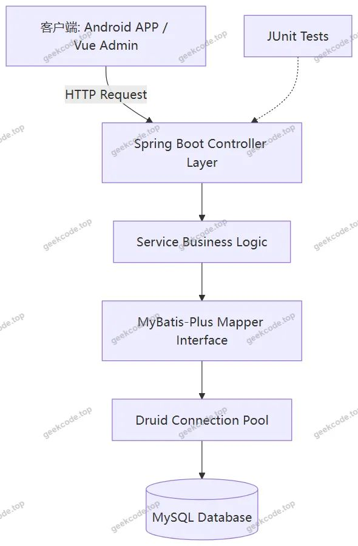
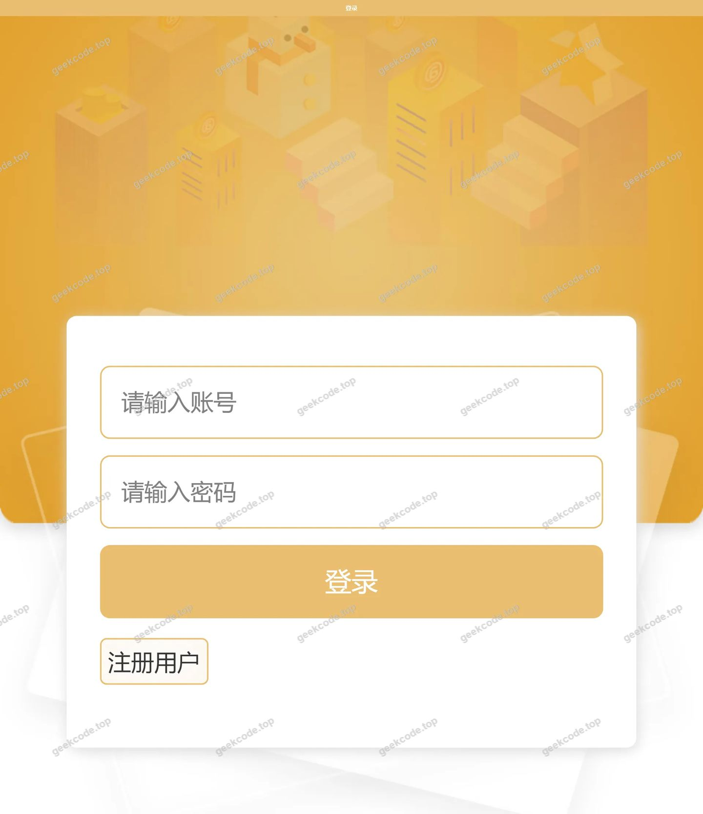
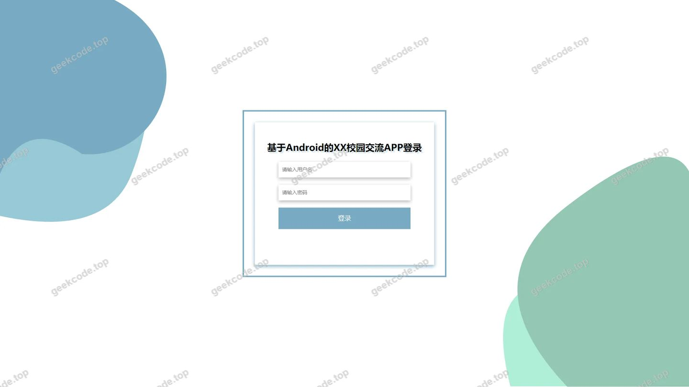
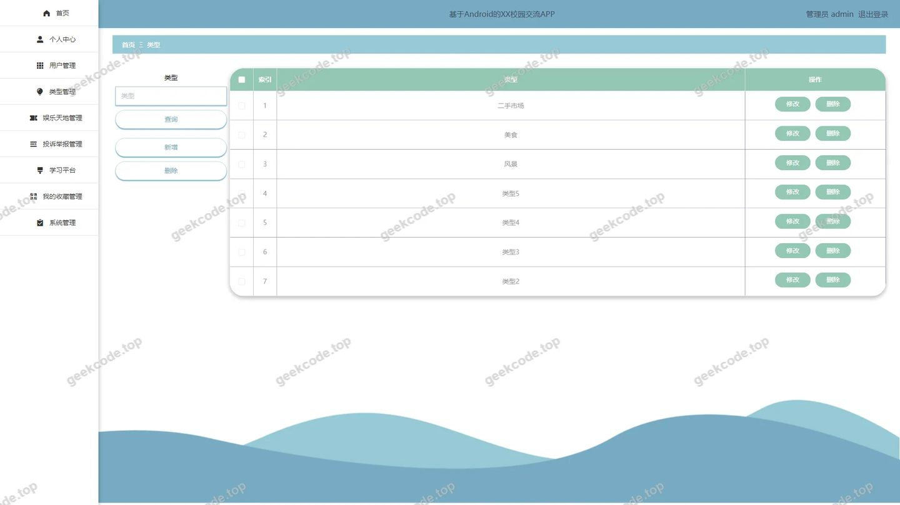
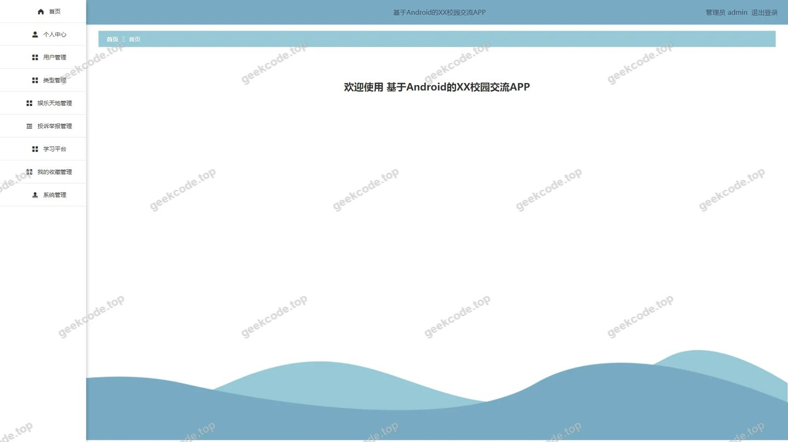
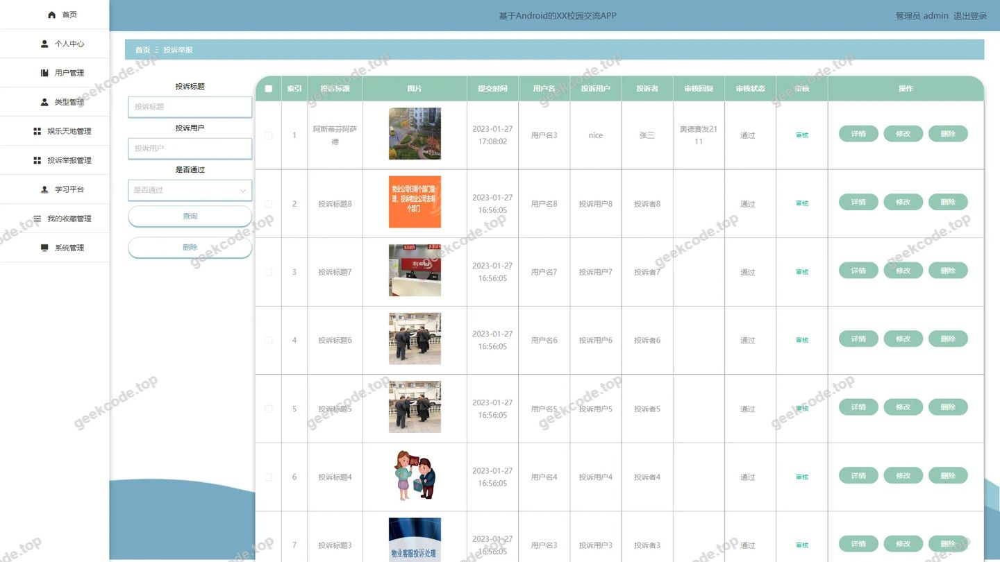
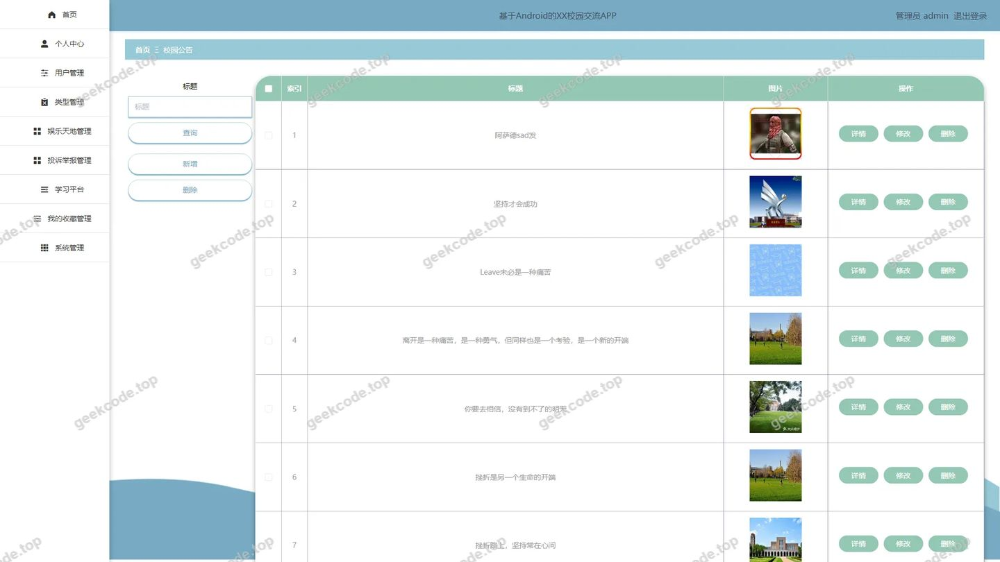
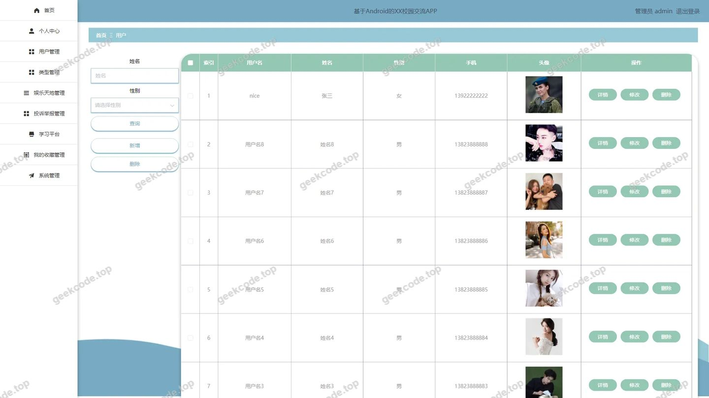
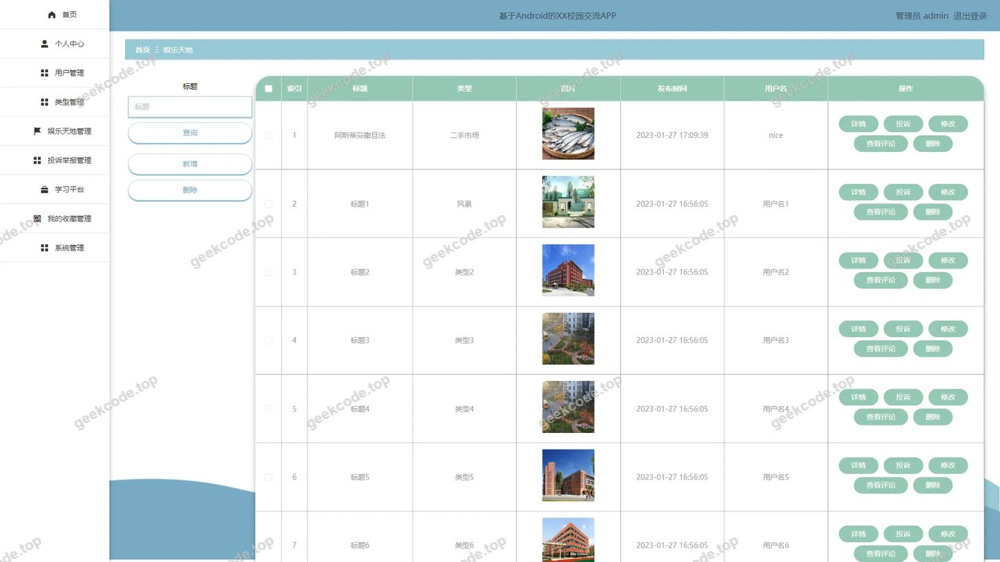
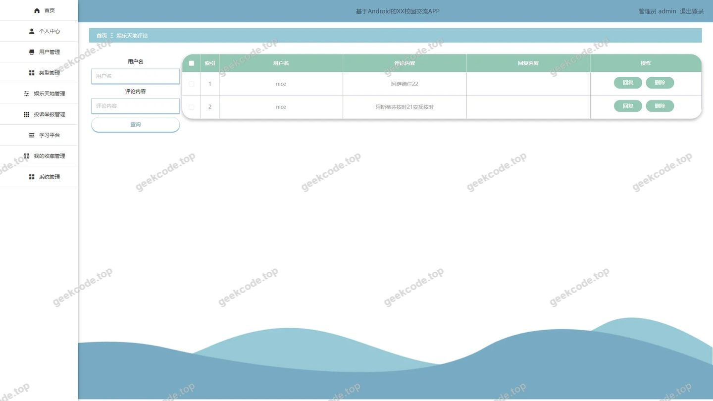

# 基于Android的XX校园交流APP--论文

> 🎓 **计算机毕业设计 · 基于Android的XX校园交流APP--论文**
>
> 本仓库只放**项目介绍 + 运行截图**（截图是站点带水印的原图，存在仓库 `images/` 里）。
>
> 👉 **完整可运行源码 / 数据库脚本 / 部署文档：[点我获取](https://geekcode.top/archives/%E5%9F%BA%E4%BA%8EAndroid%E7%9A%84XX%E6%A0%A1%E5%9B%AD%E4%BA%A4%E6%B5%81APP-%E8%AE%BA%E6%96%87?utm_source=github)**
>
> 💬 咨询微信：**ir9372**　|　🌐 更多项目：[极客代码 geekcode.top](https://geekcode.top/?utm_source=github)
>
> 📌 项目详情页：<https://geekcode.top/archives/%E5%9F%BA%E4%BA%8EAndroid%E7%9A%84XX%E6%A0%A1%E5%9B%AD%E4%BA%A4%E6%B5%81APP-%E8%AE%BA%E6%96%87?utm_source=github>

<table><td width="230" align="center"> <b>扫码加微信 ir9372</b></td><td valign="middle">📦 源码 = 项目介绍 + 全部运行截图 + 数据库 + 部署文档 👉 点上方任意截图，直接跳到 <b>极客代码 geekcode.top</b> 详情页</td></table>

---

<h1>基于Android的XX校园交流APP--论文</h1>
<h2>项目概述</h2>

本项目为“基于Android的XX校园交流APP”系统的后端服务部分，旨在构建一个高效、稳定的校园信息交互与管理平台。系统核心功能涵盖校园公告发布、娱乐天地内容分享与评论互动、用户投诉举报处理以及基础的用户管理与系统配置。通过前后端分离架构，后端提供标准化的RESTful API接口，支持前台移动端应用及后台管理界面的数据交互。适用人群主要为高校学生（作为普通用户参与交流与反馈）和校园管理员（负责内容审核、用户管理及系统维护）。技术架构上采用Spring Boot框架结合MyBatis-Plus持久层组件，利用Druid连接池优化数据库访问性能，确保在高并发场景下的数据一致性与响应速度，为校园数字化建设提供坚实的技术支撑。

<h2>技术架构</h2>

本系统采用经典的前后端分离架构设计，整体技术栈以Java为核心，具体架构描述如下：

<ol>
<li><strong>后端架构</strong>：</li>
</ol>
<ul>
<li><strong>核心框架</strong>：基于Spring Boot构建微服务化的单体应用，利用其自动配置特性快速搭建开发环境。集成Spring Core、Spring Context、Spring Web MVC等模块实现依赖注入、上下文管理及HTTP请求处理。</li>
<li><strong>持久层</strong>：采用MyBatis-Plus作为ORM框架，简化CRUD操作代码编写，提高开发效率。底层数据库连接使用Druid连接池，具备强大的监控功能和高效的资源管理能力，有效防止SQL注入并优化连接复用。</li>
<li><strong>控制层</strong>：通过一系列Controller类（如<code>ForumController</code>, <code>YonghuController</code>等）接收前端请求，调用Service层业务逻辑，返回JSON格式数据。</li>
</ul>
<ol start="2">
<li><strong>前端架构</strong>：</li>
</ol>
<ul>
<li>项目类型为<code>vue-integrated</code>，表明前端界面主要基于Vue.js框架构建。虽然源码上下文未展示具体Vue组件细节，但根据路由配置（如<code>/forum</code>, <code>/news</code>）可推断前端实现了单页面应用（SPA）模式，通过Axios等工具与后端API进行异步数据交互。</li>
</ul>
<ol start="3">
<li><strong>数据库设计要点</strong>：</li>
</ol>
<ul>
<li>数据库表结构紧密围绕业务实体设计，包括用户表（<code>yonghu</code>）、论坛帖子表（<code>forum</code>）、新闻公告表（<code>news</code>）、娱乐天地主表及评论表（<code>yuletiandi</code>, <code>discussyuletiandi</code>）、投诉举报表（<code>tousujubao</code>）、类型分类表（<code>leixing</code>）、收藏表（<code>storeup</code>）以及系统配置表（<code>config</code>）。各表之间通过外键或逻辑关联建立联系，例如评论表关联至娱乐天地主表，用户表作为所有业务数据的主体来源。</li>
</ul>
<ol start="4">
<li><strong>核心技术选型理由</strong>：</li>
</ol>
<ul>
<li>选择Spring Boot是因为其生态成熟、社区活跃且易于部署；MyBatis-Plus相比原生MyBatis减少了大量样板代码；Druid在性能和安全性上优于传统连接池，适合企业级应用。</li>
</ul>

<h2>功能模块</h2>

根据后台路由配置及控制器列表，系统主要划分为以下功能模块，分为前台用户端（隐含于API接口中）和后台管理端：

<h3>后台管理端功能模块</h3>
<ol>
<li><strong>系统登录与安全</strong></li>
</ol>
<ul>
<li><strong>模块描述</strong>：提供管理员身份验证入口，对应路由<code>/*</code>及登录页截图。确保只有授权人员才能访问后台管理系统。</li>
</ul>
<ol start="2">
<li><strong>用户管理 (<code>/yonghu</code>)</strong></li>
</ol>
<ul>
<li><strong>控制器</strong>：<code>YonghuController</code></li>
<li><strong>功能</strong>：对注册用户信息进行增删改查。管理员可查看用户列表、编辑用户资料、重置密码或删除违规账号。这是系统的基础数据维护模块。</li>
</ul>
<ol start="3">
<li><strong>校园公告管理 (<code>/news</code>)</strong></li>
</ol>
<ul>
<li><strong>控制器</strong>：<code>NewsController</code></li>
<li><strong>功能</strong>：发布和管理校园新闻公告。支持新增公告标题、内容、图片上传，以及对历史公告的修改、删除和状态切换（如置顶、隐藏）。对应截图“后台-校园公告”。</li>
</ul>
<ol start="4">
<li><strong>论坛交流管理 (<code>/forum</code>)</strong></li>
</ol>
<ul>
<li><strong>控制器</strong>：<code>ForumController</code></li>
<li><strong>功能</strong>：监控和管理校园论坛板块。管理员可以查看帖子详情、回复内容，并对违规帖子进行删除或屏蔽操作，维护社区秩序。</li>
</ul>
<ol start="5">
<li><strong>娱乐天地管理 (<code>/yuletiandi</code>)</strong></li>
</ol>
<ul>
<li><strong>控制器</strong>：<code>YuletiandiController</code></li>
<li><strong>功能</strong>：管理“娱乐天地”板块的内容发布。包括创建新的娱乐资讯、活动介绍等图文内容，支持内容的上下架管理。对应截图“后台-娱乐天地”。</li>
</ul>
<ol start="6">
<li><strong>娱乐天地评论管理 (<code>/discussyuletiandi</code>)</strong></li>
</ol>
<ul>
<li><strong>控制器</strong>：<code>DiscussyuletiandiController</code></li>
<li><strong>功能</strong>：专门针对“娱乐天地”板块下的用户评论进行审核与管理。管理员可查看所有评论，删除恶意或不实评论，保障评论区健康环境。对应截图“后台-娱乐天地评论”。</li>
</ul>
<ol start="7">
<li><strong>投诉举报处理 (<code>/tousujubao</code>)</strong></li>
</ol>
<ul>
<li><strong>控制器</strong>：<code>TousujubaoController</code></li>
<li><strong>功能</strong>：接收并处理来自用户的投诉与举报信息。管理员可查看举报详情、证据材料，并进行受理、驳回或转交相关部门处理的操作。对应截图“后台-投诉举报”。</li>
</ul>
<ol start="8">
<li><strong>类型分类管理 (<code>/leixing</code>)</strong></li>
</ol>
<ul>
<li><strong>控制器</strong>：<code>LeixingController</code></li>
<li><strong>功能</strong>：维护系统中的内容分类标签。例如定义公告类别、娱乐内容子类、论坛版块分类等，便于前端进行筛选和展示。对应截图“后台-类型”。</li>
</ul>
<ol start="9">
<li><strong>我的收藏/记录管理 (<code>/storeup</code>)</strong></li>
</ol>
<ul>
<li><strong>控制器</strong>：<code>StoreupController</code></li>
<li><strong>功能</strong>：虽然通常为用户侧功能，但在后台路由中存在，可能用于管理员查看全站用户的收藏数据统计，或作为系统测试用的数据清理入口。</li>
</ul>
<ol start="10">
<li><strong>系统配置 (<code>/config</code>)</strong></li>
</ol>
<ul>
<li><strong>控制器</strong>：<code>ConfigController</code></li>
<li><strong>功能</strong>：管理系统的全局参数配置，如轮播图设置、网站名称、版权信息、开关状态等。支持动态修改无需重启服务。</li>
</ul>
<ol start="11">
<li><strong>通用文件服务 (<code>FileController</code> &amp; <code>CommonController</code>)</strong></li>
</ol>
<ul>
<li><strong>功能</strong>：提供统一的文件上传下载接口（如头像、公告配图），以及通用的字典数据查询、验证码生成等辅助功能。</li>
</ul>
<h3>前台用户端功能模块（基于API推导）</h3>

<em>注：由于上下文未提供具体的前台Vue页面代码，以下功能基于后台提供的API接口反向推导得出。</em>

<ol>
<li><strong>用户注册与登录</strong>：通过<code>YonghuController</code>提供的接口完成身份认证。</li>
<li><strong>浏览校园公告</strong>：调用<code>NewsController</code>接口获取最新校园新闻。</li>
<li><strong>参与论坛讨论</strong>：通过<code>ForumController</code>接口发帖、回帖。</li>
<li><strong>浏览娱乐资讯</strong>：访问<code>YuletiandiController</code>获取娱乐内容，并通过<code>DiscussyuletiandiController</code>发表评论。</li>
<li><strong>提交投诉举报</strong>：使用<code>TousujubaoController</code>接口上报问题。</li>
<li><strong>内容收藏</strong>：通过<code>StoreupController</code>接口收藏感兴趣的文章或帖子。</li>
</ol>
<h2>用户角色与权限</h2>

系统主要涉及两类角色：超级管理员和普通用户。根据现有代码结构和路由配置，权限划分如下：

<h3>1. 超级管理员 (Admin)</h3>
<ul>
<li><strong>访问范围</strong>：拥有后台管理系统的所有权限，可访问所有定义的后台路由。</li>
<li><strong>具体功能权限</strong>：</li>
<li><strong>用户管理</strong>：完全控制<code>/yonghu</code>模块，可添加、修改、删除用户账户。</li>
<li><strong>内容发布与维护</strong>：</li>
<li>管理<code>/news</code>（校园公告）：全权负责公告的创建、编辑、删除。</li>
<li>管理<code>/yuletiandi</code>（娱乐天地）：全权负责娱乐内容的创建、编辑、删除。</li>
<li>管理<code>/leixing</code>（类型）：定义和维护内容分类体系。</li>
<li><strong>社区治理</strong>：</li>
<li>审核<code>/forum</code>（论坛）：查看并管理所有论坛帖子。</li>
<li>审核<code>/discussyuletiandi</code>（评论）：查看并管理所有娱乐天地的评论。</li>
<li>处理<code>/tousujubao</code>（投诉）：查看、处理所有用户的投诉举报记录。</li>
<li><strong>系统设置</strong>：修改<code>/config</code>中的系统全局参数。</li>
<li><strong>数据统计</strong>：查看<code>/storeup</code>相关的收藏数据记录。</li>
</ul>
<h3>2. 普通用户 (User)</h3>
<ul>
<li><strong>访问范围</strong>：主要通过Android APP或前台Web界面访问，无后台管理权限。</li>
<li><strong>具体功能权限</strong>：</li>
<li><strong>个人信息</strong>：注册、登录、修改个人资料。</li>
<li><strong>内容消费</strong>：浏览公告、娱乐资讯、论坛帖子。</li>
<li><strong>内容生产</strong>：</li>
<li>在论坛发帖、回复。</li>
<li>在娱乐天地发表评论。</li>
<li>提交投诉举报。</li>
<li>收藏喜欢的内容。</li>
<li><strong>限制</strong>：无法直接修改他人内容，无法访问后台管理界面，无法修改系统配置。</li>
</ul>

<em>注：根据现有信息，未发现教师或其他特殊角色的独立权限定义，系统似乎仅区分管理员与普通注册用户。</em>

<h2>项目特色与创新点</h2>
<ol>
<li>
<strong>模块化与解耦设计</strong>：
   系统严格遵循MVC分层架构，将业务逻辑封装在独立的Controller中（如将娱乐天地与其评论分开管理，<code>YuletiandiController</code>与<code>DiscussyuletiandiController</code>独立），这种细粒度的模块划分使得代码维护更加清晰，便于后续功能的扩展与迭代。

</li>
<li>
<strong>高效的持久层实践</strong>：
   引入MyBatis-Plus显著减少了重复的DAO层代码编写工作，配合Druid连接池的高性能特性，在处理校园高并发访问（如选课期间或大型活动公告发布时）能够提供稳定的数据库读写支持，提升了系统的整体吞吐量。

</li>
<li>
<strong>完善的社区治理闭环</strong>：
   项目不仅提供了内容发布功能（公告、娱乐、论坛），还配套了完整的监管机制（评论管理、投诉举报处理）。这种“发布-互动-反馈-处理”的闭环设计，有效解决了校园网络平台常见的信息杂乱、谣言传播等问题，保障了校园交流环境的健康有序。

</li>
<li>
<strong>灵活的系统配置能力</strong>：
   通过<code>ConfigController</code>和<code>/config</code>路由，实现了系统参数的动态化管理。管理员可以在不重启服务的情况下调整站点基本信息或功能开关，提高了运维效率和用户体验的灵活性。

</li>
</ol>
<h2>部署环境</h2>

为确保项目正常运行，需准备以下软件环境：

<ol>
<li><strong>操作系统</strong>：Windows 10/11, Linux (CentOS 7+, Ubuntu 18.04+) 或 macOS。</li>
<li><strong>Java运行环境</strong>：JDK 1.8 或更高版本（建议JDK 1.8 LTS，兼容性好）。</li>
<li><strong>数据库</strong>：MySQL 5.7 或 MySQL 8.0。需提前创建对应的数据库实例并导入初始化SQL脚本。</li>
<li><strong>构建工具</strong>：Maven 3.6+。用于依赖管理和项目打包。</li>
<li><strong>前端环境</strong>：Node.js (建议v12-v16版本) 和 npm/yarn。用于编译Vue前端资源。</li>
<li><strong>Web服务器</strong>：Nginx（可选，用于反向代理和静态资源托管）或 Tomcat（内置于Spring Boot Jar包中，可直接运行）。</li>
<li><strong>开发工具</strong>：IntelliJ IDEA 或 Eclipse（后端开发）；VS Code（前端开发）；Navicat 或 MySQL Workbench（数据库管理）。</li>
<li><strong>Android开发环境</strong>（如需调试APP端）：Android Studio。</li>
</ol>
<h2>五、技术特性</h2>
<ul>
<li>前后端集成部署，前端资源打包至后端 static 目录</li>
<li>使用 MyBatis-Plus 简化数据访问层开发</li>
</ul>
<h2>六、功能模块截图</h2>
<h3>前台用户端</h3>
<h4>前台首页框架</h4>

<h3>后台管理端</h3>
<h4>后台-登录页</h4>

<h4>后台-类型</h4>

<h4>后台首页</h4>

<h4>后台-投诉举报</h4>

<h4>后台-校园公告</h4>

<h4>后台-用户</h4>

<h4>后台-娱乐天地</h4>

<h4>后台-娱乐天地评论</h4>

---

## 获取完整源码

| 项目 | 说明 |
| --- | --- |
| 项目名 | 基于Android的XX校园交流APP--论文 |
| 运行截图 | 本文 10 张（站点带水印原图，仓库 `images/` 目录） |
| 完整源码 | [https://geekcode.top/archives/%E5%9F%BA%E4%BA%8EAndroid%E7%9A%84XX%E6%A0%A1%E5%9B%AD%E4%BA%A4%E6%B5%81APP-%E8%AE%BA%E6%96%87?utm_source=github](https://geekcode.top/archives/%E5%9F%BA%E4%BA%8EAndroid%E7%9A%84XX%E6%A0%A1%E5%9B%AD%E4%BA%A4%E6%B5%81APP-%E8%AE%BA%E6%96%87?utm_source=github) |
| 咨询微信 | **ir9372**（备注：jingpin-yuanma） |
| 更多项目 | [极客代码 geekcode.top](https://geekcode.top/?utm_source=github) |

> 需要源码、部署、改配置、跑不起来等问题，加微信 ir9372 沟通，说明项目名即可。
